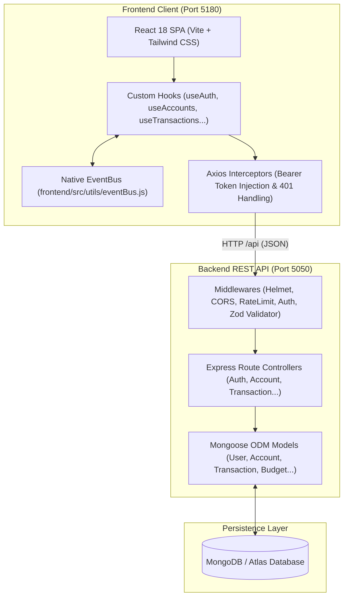

# 📊 MERN Expense Tracker & Personal Finance Engine

[](https://mongodb.com)
[](https://vitejs.dev)
[](https://tailwindcss.com)
[](https://zod.dev)
[](https://recharts.org)
[](https://react-icons.github.io/react-icons/)
[](https://jestjs.io)
[](https://vitest.dev)

A comprehensive, production-ready full-stack personal finance application built with the **MERN** stack (MongoDB, Express, React 18, Node.js). Designed for precision budgeting, multi-account liquid vs. segregated asset tracking, smart calendar recurrence forecasting, dynamic financial analytics, and robust multi-tenant data isolation.

---

## 📑 Table of Contents

- [System Architecture](#-system-architecture)
- [Strict Architectural Principles](#-strict-architectural-principles)
- [Core Feature Breakdown](#-core-feature-breakdown)
- [Complete REST API Specification](#-complete-rest-api-specification)
- [Port Configuration & Restrictions](#-port-configuration--restrictions)
- [Environment Variables Guide](#-environment-variables-guide)
- [Local Setup & Installation](#-local-setup--installation)
- [Testing Suite & Quality Assurance](#-testing-suite--quality-assurance)
- [Production Deployment Guide](#-production-deployment-guide)
- [What We Can Improve (Future Enhancements)](#-what-we-can-improve-future-enhancements)
- [Known Limitations](#-known-limitations)

---

## 🏛 System Architecture

The Expense Tracker follows a decoupled client-server architecture with an asynchronous, decoupled event-bus communication layer on the frontend, and a layered Controller-Service-Repository architecture on the backend.



---

## ⚡ Strict Architectural Principles

### 1. State Management: Zero External State Stores
To guarantee predictable data flow and eliminate the memory overhead and boilerplate of Redux, RTK Query, or excessive re-renders from React Context API, state is managed entirely through:
- **Pure Custom React Hooks**: (`useAuth`, `useAccounts`, `useTransactions`, `useBudgets`, `useGoals`, `useRecurring`, `useAnalytics`, `useCategories`).
- **Decoupled Native Event Bus (`frontend/src/utils/eventBus.js`)**:
  - Components broadcast standardized lifecycle events (e.g., `TRANSACTION_CREATED`, `ACCOUNT_UPDATED`, `BUDGET_UPDATED`, `GOAL_CONTRIBUTED`).
  - Active subscriber hooks listening to relevant topics automatically re-fetch synchronized backend state.
  - No global Context wrappers; zero unnecessary DOM re-renders.

### 2. Iconography Standard: Strict React Icons
- The project strictly uses `react-icons` (such as `react-icons/fa`, `react-icons/md`, `react-icons/bi`, `react-icons/ri`).
- External icon libraries such as `lucide-react` are **strictly forbidden** and excluded from dependencies.

### 3. Strict Port Allocation
- **Frontend Client**: Runs on **Port 5180** exclusively (`frontend/vite.config.js`).
- **Backend Server API**: Runs on **Port 5050** exclusively (`backend/src/server.js`).
- **Forbidden Ports**: Ports `3000`, `5173`, and `5022` are strictly blacklisted to avoid cross-project collision.

---

## 💎 Core Feature Breakdown

### 1. Authentication, Security & Multi-Tenant Isolation
- **Token Security**: Industry-standard JSON Web Tokens (JWT) signed with HMAC-SHA256 and stored in secure browser storage.
- **Password Hashing**: Irreversible `bcryptjs` salt hashing (10 salt rounds).
- **Brute-Force Rate Limiting**: `express-rate-limit` prevents brute-force login attempts (10 requests per 15 minutes per IP; automatically skipped in automated test mode).
- **Input Sanitization & Schema Validation**: Express request validation via **Zod** (`validators/*.js`). Invalid inputs return structured HTTP 400 validation error summaries before touching business logic.
- **Multi-Tenant User Isolation**: Every database collection indexes `{ user: ObjectId }`. All queries (`find`, `findById`, `findOneAndUpdate`, `deleteMany`) rigorously scope queries to `req.user._id`, ensuring zero possibility of cross-user data leakage.

### 2. Real-Time Financial Dashboard
- **Liquid Net Balance**: Aggregates all liquid accounts (Cash, Bank, Credit Card, Wallet) while keeping Segregated Savings isolated.
- **Monthly Budget Consumption**: Real-time visual progress indicator for total monthly budget limits.
- **Income vs. Expense Ratio**: Quick ratio metrics calculating cashflow velocity.
- **Recent Activity Feed**: The 5 most recent transactions with immediate visual categorization and amount sign formatting.
- **Quick Add Transaction Modal**: Controlled modal available directly from the primary navigation bar.

### 3. Multi-Account Management & Segregated Savings
- Supported account types: `Cash`, `Bank`, `Credit Card`, `Wallet`, and `Savings`.
- **Segregated Savings Protection**: Accounts typed as `Savings` are excluded from liquid spending balances to prevent accidental depletion of emergency reserves. They feature custom badges and dedicated contribution mechanisms.
- **Atomic Balance Updates**: Transaction creations, updates, deletions, and goal contributions dynamically update associated account balances.

### 4. Transactions Engine & History Explorer
- **Full CRUD Support**: Add, edit, and delete transactions with immediate account balance recalculation.
- **Multi-Criteria Combinable Filters**: Combine Search keyword, Transaction Type (`income` / `expense`), Account selection, Category selection, and Date Range (`startDate`, `endDate`).
- **Server-Side Pagination**: Efficient pagination (`page`, `limit`) preserving active filter queries.
- **Contextual Categorization**: Dynamic icon mappings based on transaction categories.

### 5. CSV Export Engine
- Preserves all active client search and filter parameters.
- Formats dates in ISO/localized format, labels account names, category names, notes, and values directly into RFC 4180 compliant CSV files.

### 6. Dynamic Budgeting & Threshold Warning System
- **Per-Category & Overall Limits**: Configure total monthly spending limits alongside targeted category limits (e.g., Dining, Groceries, Rent).
- **Color-Coded Alert Thresholds**:
  - `0% - 49%`: Green / Emerald (Safe zone)
  - `50% - 89%`: Blue / Yellow (Moderate spending alert)
  - `90% - 99%`: Orange / Amber (Nearing threshold alert)
  - `100%+`: Red / Crimson (Budget exceeded warning)
- Month/Year selector allowing historical budget reviews.

### 7. Recurring Transactions & Due Date Notification Center
- **Frequencies**: Supports `daily`, `weekly`, `monthly`, and `yearly` recurrences.
- **Intelligent Calendar Math**: Accurately computes future due dates handling leap years and variable month lengths.
- **Notification Center**: Notification bell in the navigation bar displays overdue and upcoming obligations.
- **One-Click "Mark as Paid"**: Creates an authorized transaction record, updates the account balance, and automatically advances the next due date by exactly one frequency cycle.

### 8. Savings Goals Tracker
- Create personalized savings targets with target amounts, current progress, and target completion dates.
- Dynamic percentage calculations: `(currentAmount / targetAmount) * 100`.
- **Dedicated Contributions**: Option to deduct contribution funds directly from a liquid checking/savings account or record an external gift.
- Auto-completes and updates badge status upon reaching 100%.

### 9. Visual Analytics & Reporting Engine
- Dynamic date-range aggregation across **Week**, **Month**, **3 Months**, and **Year**.
- **Interactive Recharts Charts**:
  - **Spending Trend Bar/Area Chart**: Income vs. Expense comparison over time.
  - **Category Donut / Pie Breakdown**: Visual percentage distribution of top expense categories with custom color palettes.

---

## 📡 Complete REST API Specification

All protected endpoints require the HTTP Header: `Authorization: Bearer <JWT_TOKEN>`.

### Authentication Endpoints (`/api/auth`)
| Method | Endpoint | Purpose | Auth Required | Request Body / Query Params |
| :--- | :--- | :--- | :---: | :--- |
| `POST` | `/api/auth/register` | Register new user | No | `{ "name": "Safdar", "email": "user@test.com", "password": "Password123!", "currency": "USD" }` |
| `POST` | `/api/auth/login` | Authenticate user | No | `{ "email": "user@test.com", "password": "Password123!" }` |
| `GET` | `/api/auth/me` | Fetch active profile | Yes | None |

### Account Endpoints (`/api/accounts`)
| Method | Endpoint | Purpose | Auth Required | Request Body / Query Params |
| :--- | :--- | :--- | :---: | :--- |
| `GET` | `/api/accounts` | List user accounts | Yes | None |
| `POST` | `/api/accounts` | Create an account | Yes | `{ "name": "Chase Checking", "type": "Bank", "balance": 1500 }` |
| `PUT` | `/api/accounts/:id` | Update an account | Yes | `{ "name": "Chase Checking", "balance": 1800 }` |
| `DELETE` | `/api/accounts/:id` | Delete an account | Yes | None |

### Category Endpoints (`/api/categories`)
| Method | Endpoint | Purpose | Auth Required | Request Body / Query Params |
| :--- | :--- | :--- | :---: | :--- |
| `GET` | `/api/categories` | List system & custom categories | Yes | None |
| `POST` | `/api/categories` | Create custom category | Yes | `{ "name": "Freelance", "type": "income", "icon": "FaLaptopCode", "color": "#10B981" }` |

### Transaction Endpoints (`/api/transactions`)
| Method | Endpoint | Purpose | Auth Required | Request Body / Query Params |
| :--- | :--- | :--- | :---: | :--- |
| `GET` | `/api/transactions` | Paginated, filtered list | Yes | Query: `?page=1&limit=10&type=expense&category=&account=&startDate=&endDate=&search=` |
| `POST` | `/api/transactions` | Create transaction | Yes | `{ "amount": 45.50, "type": "expense", "category": "<id>", "account": "<id>", "date": "2026-11-21", "note": "Groceries" }` |
| `GET` | `/api/transactions/export` | Export filtered CSV | Yes | Query: Same filter params as `/api/transactions` |
| `GET` | `/api/transactions/:id` | Retrieve single item | Yes | None |
| `PUT` | `/api/transactions/:id` | Update transaction | Yes | `{ "amount": 50.00, "note": "Updated note" }` |
| `DELETE` | `/api/transactions/:id` | Delete transaction | Yes | None |

### Budget Endpoints (`/api/budgets`)
| Method | Endpoint | Purpose | Auth Required | Request Body / Query Params |
| :--- | :--- | :--- | :---: | :--- |
| `GET` | `/api/budgets/current` | Current month spend vs limit | Yes | Query: `?month=11&year=2026` |
| `POST` | `/api/budgets` | Upsert monthly budget limits | Yes | `{ "month": 11, "year": 2026, "overallLimit": 2500, "categoryBudgets": [{ "category": "<id>", "limit": 400 }] }` |

### Savings Goal Endpoints (`/api/goals`)
| Method | Endpoint | Purpose | Auth Required | Request Body / Query Params |
| :--- | :--- | :--- | :---: | :--- |
| `GET` | `/api/goals` | List all savings goals | Yes | None |
| `POST` | `/api/goals` | Create a savings goal | Yes | `{ "title": "Emergency Fund", "targetAmount": 5000, "targetDate": "2026-12-31" }` |
| `GET` | `/api/goals/:id` | Get goal details | Yes | None |
| `PUT` | `/api/goals/:id` | Update goal | Yes | `{ "title": "Emergency Fund", "targetAmount": 6000 }` |
| `DELETE` | `/api/goals/:id` | Delete goal | Yes | None |
| `POST` | `/api/goals/:id/contribute` | Add savings contribution | Yes | `{ "amount": 250, "accountId": "<id>" }` |

### Recurring Transaction Endpoints (`/api/recurring`)
| Method | Endpoint | Purpose | Auth Required | Request Body / Query Params |
| :--- | :--- | :--- | :---: | :--- |
| `GET` | `/api/recurring` | List recurring rules & due dates | Yes | None |
| `POST` | `/api/recurring` | Create recurring rule | Yes | `{ "amount": 1200, "type": "expense", "category": "<id>", "account": "<id>", "frequency": "monthly", "startDate": "2026-11-01" }` |
| `GET` | `/api/recurring/:id` | Get rule details | Yes | None |
| `PUT` | `/api/recurring/:id` | Update recurring rule | Yes | `{ "amount": 1250 }` |
| `DELETE` | `/api/recurring/:id` | Delete rule | Yes | None |
| `POST` | `/api/recurring/:id/pay` | Mark rule as paid | Yes | None |

### Analytics Endpoints (`/api/analytics`)
| Method | Endpoint | Purpose | Auth Required | Request Body / Query Params |
| :--- | :--- | :--- | :---: | :--- |
| `GET` | `/api/analytics/overview` | Lifetime & monthly totals | Yes | None |
| `GET` | `/api/analytics/categories`| Categorical expense breakdown | Yes | Query: `?timeframe=month` (week / month / 3m / year) |
| `GET` | `/api/analytics/trends` | Time-series trends (zero-filled) | Yes | Query: `?timeframe=month` (week / month / 3m / year) |

### Health Check Endpoint (`/api/health`)
| Method | Endpoint | Purpose | Auth Required | Response |
| :--- | :--- | :--- | :---: | :--- |
| `GET` | `/api/health` | Service uptime and heartbeat | No | `{ "success": true, "status": "ok", "timestamp": "..." }` |

---

## 🔒 Port Configuration & Restrictions

| Service | Designated Port | Allowed Alternates | Forbidden Ports |
| :--- | :---: | :---: | :---: |
| **Backend API** | `5050` | None | `3000`, `5173`, `5022` |
| **Frontend Client** | `5180` | None | `3000`, `5173`, `5022` |

> [!WARNING]
> Vite has been locked with `strictPort: true` on `5180`. Express fails explicitly if `PORT` is bound to any forbidden port.

---

## ⚙️ Environment Variables Guide

### Backend (`backend/.env`)
| Variable | Description | Default Development Value |
| :--- | :--- | :--- |
| `PORT` | Listening TCP port for Express server | `5050` |
| `MONGO_URI` | MongoDB connection URI string | `mongodb://127.0.0.1:27017/expense_tracker` |
| `JWT_SECRET` | Secret key for signing JSON Web Tokens | `super_secret_jwt_key_for_development_12345!` |
| `CLIENT_URL`| Whitelisted frontend URL for CORS | `http://localhost:5180` |
| `NODE_ENV`  | Runtime environment mode | `development` |

### Frontend (`frontend/.env`)
| Variable | Description | Default Development Value |
| :--- | :--- | :--- |
| `VITE_API_BASE_URL` | Base API prefix (handled by Vite reverse proxy) | `/api` |

---

## 🚀 Local Setup & Installation

### Prerequisites
- **Node.js**: `v18.0.0` or higher
- **npm**: `v9.0.0` or higher
- **MongoDB**: Local MongoDB instance (`mongod`) running on `27017` or a MongoDB Atlas connection string.

### Step-by-Step Installation

1. **Clone the Repository**
   ```bash
   git clone https://github.com/<your-username>/expense-tracker.git
   cd expense-tracker
   ```

2. **Install Root and Workspace Dependencies**
   ```bash
   # Install root orchestration tools
   npm install

   # Install backend dependencies
   npm install --prefix backend

   # Install frontend dependencies
   npm install --prefix frontend
   ```

3. **Configure Environment Files**
   ```bash
   # Backend environment setup
   cp backend/.env.example backend/.env

   # Frontend environment setup
   cp frontend/.env.example frontend/.env
   ```

4. **Launch the Application**
   You can run both frontend and backend concurrently from the root directory:
   ```bash
   npm run dev
   ```

   Or run them independently in separate terminal windows:
   ```bash
   # Terminal 1 - Backend Server (Port 5050)
   npm run backend

   # Terminal 2 - Frontend Client (Port 5180)
   npm run frontend
   ```

5. **Access the Application**
   - Open your browser at: [http://localhost:5180](http://localhost:5180)
   - Register a new account to automatically seed default accounts (`Cash`, `Bank Checking`, `Savings`) and categories (`Food`, `Rent`, `Salary`, `Utilities`).

---

## 🧪 Testing Suite & Quality Assurance

The project enforces high test coverage across both backend and frontend layers.

### Run Frontend Tests (Vitest)
Executes all 42 frontend test suites (272 tests) validating hooks, event bus synchronization, modals, and page rendering:
```bash
npm test --prefix frontend
```
*Expected Result:*
```
Test Files  42 passed (42)
Tests       272 passed (272)
```

### Run Backend Tests (Jest & Supertest)
Executes all 7 integration test suites (111 tests) with full database teardowns and multi-tenant security verification:
```bash
npm test --prefix backend
```
*Expected Result:*
```
Test Suites  7 passed (7)
Tests        111 passed (111)
```

---

## 🌐 Production Deployment Guide

### 1. MongoDB Atlas Database Setup
1. Create a free M0 cluster on [MongoDB Atlas](https://www.mongodb.com/cloud/atlas).
2. Under **Database Access**, create a user with read/write privileges.
3. Under **Network Access**, whitelist your deployment IPs (or `0.0.0.0/0` for cloud PaaS).
4. Obtain your connection URI: `mongodb+srv://<username>:<password>@cluster0.mongodb.net/expense_tracker?retryWrites=true&w=majority`.

### 2. Backend Deployment (Render / Railway)
1. Link your Git repository to **Render** as a **Web Service**.
2. **Root Directory**: `backend`
3. **Build Command**: `npm install`
4. **Start Command**: `npm start`
5. Configure Environment Variables in Render Dashboard:
   - `PORT`: `5050`
   - `MONGO_URI`: `<your-mongodb-atlas-uri>`
   - `JWT_SECRET`: `<generated-secure-random-secret>`
   - `CLIENT_URL`: `https://your-frontend-app.vercel.app`
   - `NODE_ENV`: `production`

### 3. Frontend Deployment (Vercel / Netlify)
1. Link your Git repository to **Vercel**.
2. **Framework Preset**: `Vite`
3. **Root Directory**: `frontend`
4. **Build Command**: `npm run build`
5. **Output Directory**: `dist`
6. Configure Environment Variables in Vercel:
   - `VITE_API_BASE_URL`: `https://your-backend-api.onrender.com/api`
7. In `frontend/vercel.json`, ensure SPA client-side route rewrites are enabled:
   ```json
   {
     "rewrites": [
       { "source": "/(.*)", "destination": "/index.html" }
     ]
   }
   ```

---

## 💡 What We Can Improve (Future Enhancements)

While the application fulfills all core expense tracking, budgeting, and analytics requirements, the following key features represent the highest-priority enhancements for subsequent versions:

### 1. Automated UPI & Online Banking Integration
* **Real-Time Payment Webhooks**: Integrate with Indian UPI rails (NPCI / Setu / RazorpayX Account Aggregator APIs) or SMS consent parser on mobile.
* **Zero-Effort Expense Capture**: Whenever a user completes an online UPI payment (via Google Pay, PhonePe, Paytm, or net banking), the transaction is automatically captured and recorded as an **Expense** with intelligent merchant-based category tagging (e.g. Swiggy/Zomato -> Food, Uber/Ola -> Travel).
* **Automatic Inflow Detection**: When funds are received via UPI ID or direct account deposit, the engine automatically records the amount as **Income** and updates the associated wallet balance instantly, removing the friction of manual data entry.

### 2. Inter-Account Funds Transfer & ATM Cash Management
* **Account-to-Account Transfers**: Add a dedicated "Transfer Funds" workflow allowing users to move money between accounts (e.g., Bank Checking ⇄ Cash, or Wallet ⇄ Bank).
* **ATM Cash Withdrawal Tracking**: When a user withdraws cash from an ATM:
  - The withdrawn sum is deducted from their **Bank Account (Online Balance)**.
  - The exact same amount is credited to their **Cash Account (Physical Wallet)**.
  - Crucially, this operation is recorded as a balance rebalancing transfer rather than a net expense or income, ensuring monthly budget spending and analytics charts remain completely accurate.
* **Cash Deposit Reversal**: Similarly supports physical cash deposits at CDMs or bank branches, moving funds from Cash to Bank Checking with zero ledger drift.

### 3. Additional Planned Features
* **AI Receipt & Invoice OCR**: Optical Character Recognition (OCR) via Google Cloud Vision or Tesseract to extract merchant name, transaction date, line items, and total amount directly from uploaded receipts.
* **Web Push Notifications**: Service Worker push notifications alerting users 24–48 hours before recurring EMI, rent, or subscription payments become overdue.
* **Multi-Currency & Live Forex Rates**: Real-time currency conversions via OpenExchangeRates API for users managing multi-currency bank accounts or international travel budgets.
* **Two-Factor Authentication (2FA)**: Time-based One-Time Password (TOTP) authentication via Google Authenticator or Authy for elevated security.

---

## 🧭 Known Limitations

- **Single Currency Base**: While users can set their preferred currency symbol on registration, multi-currency conversion with live forex rates is not yet supported.
- **Manual Receipt Attachments**: Receipts and invoice uploads are currently limited to text notes rather than binary image/PDF uploads.

---

## 📄 License

This project is licensed under the MIT License. Developed for technical demonstration and internship evaluation.
