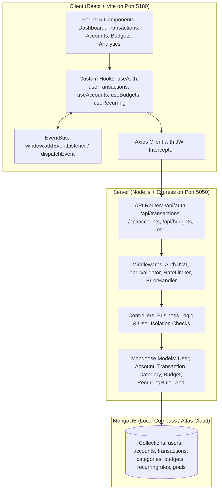

# Expense Tracker Web App (MERN) Implementation Plan

> **For agentic workers:** REQUIRED SUB-SKILL: Use superpowers:subagent-driven-development (recommended) or superpowers:executing-plans to implement this plan task-by-task. Steps use checkbox (`- [ ]`) syntax for tracking.

**Goal:** Build a production-grade, secure, responsive MERN Expense Tracker with strict user isolation, multi-account/savings segregation, budget warning notifications, recurring due-date tracking, dynamic analytics, and complete test suites.

**Architecture:** MVC backend (Node.js/Express/MongoDB/Zod) communicating over a REST API with a React (Vite/Tailwind CSS/react-icons) frontend. State reactivity is driven by modular React Custom Hooks (`useState`, `useEffect`) coordinated via a native browser `addEventListener` / `dispatchEvent` event bus (`eventBus.js`), completely avoiding Redux or Context API complexity.

**Architecture Diagram:**

**Tech Stack:** 
- Frontend: React 18, Vite, Tailwind CSS, `react-icons`, Recharts, Axios, Vitest + React Testing Library
- Backend: Node.js, Express, MongoDB (Mongoose), Zod, `bcryptjs`, `jsonwebtoken`, `express-rate-limit`, `cors`, Jest + Supertest

**Spec:** [`docs/superpowers/specs/2026-11-19-expense-tracker-design.md`](file:///c:/Users/sk800/OneDrive/Desktop/ZA%20Charity%20Feed%20Fundation/docs/superpowers/specs/2026-11-19-expense-tracker-design.md)

---

## Global Constraints

- **Port Restrictions**: Server MUST run on port `5050` (or configured via `PORT` env). Client MUST run on port `5180`. Ports `3000`, `5173`, and `5022` are strictly forbidden as they are in active use on the user's host machine.
- **State Management**: Strictly NO Redux, NO RTK Query, and NO Context API. State must be handled using pure functional React hooks (`useState`, `useEffect`) and native `window.addEventListener` / `window.dispatchEvent` for component synchronization.
- **Icons**: Use `react-icons` (`Fa*`, `Md*`, `Hi*`, etc.) exclusively — do NOT install or import `lucide-react`.
- **Code Style & Documentation**: Extensive, beginner-friendly inline comments must accompany every controller, model, route, hook, and major UI component explaining the logic.
- **Security & Data Isolation**: Every database write and read must explicitly filter by `{ userId: req.user._id }`.
- **Validation**: Every write request must be validated with Zod schemas.

---

## Review Focus

1. **Cross-Tenant Access Attempt**: User B crafts an API request passing User A's transaction ID. System must return 404 (Not Found), never 200 or 500.
2. **Savings Account Segregation**: User records an expense choosing "Savings" as the source account. The Savings balance must decrease, but the "Wallet" and "Cash" balances must remain unchanged.
3. **Budget Alert Thresholds**: Monthly spending reaches 50%, 90%, 100%, and >100% of the defined overall or category limit. System must generate appropriate alert badges and notification items.
4. **Recurring Due Date Notification & Action**: A recurring expense scheduled for today appears in the notification bell. Clicking "Mark as Paid" creates an actual transaction and advances `nextDueDate` by the recurring interval.
5. **Pagination & Combinable Filters**: Transaction list with page=1, limit=10, type=Expense, and category filter returns correct sliced data with accurate totalPages without pulling the full collection to the client.

---

## Implementation Tasks

### Task 1: Project Scaffolding & Configuration

**Files:**
- Create: `package.json` (root workspace scripts)
- Create: `.gitignore`
- Create: `server/package.json`
- Create: `server/.env.example`
- Create: `server/.env`

**Interfaces:**
- Root scripts: `npm run dev` (starts both client on 5180 and server on 5050), `npm run server`, `npm run client`, `npm test`
- Ports: Server `PORT=5050`, Client `5180`

- [ ] **Step 1: Create root `.gitignore` and root `package.json`**
Configure concurrently/scripts to run both client and server simultaneously.
- [ ] **Step 2: Scaffold `server/package.json`**
Include dependencies: `express`, `mongoose`, `dotenv`, `cors`, `helmet`, `bcryptjs`, `jsonwebtoken`, `zod`, `express-rate-limit`. Dev dependencies: `jest`, `supertest`, `nodemon`.
- [ ] **Step 3: Create `server/.env.example` and `server/.env`**
Set `PORT=5050`, `MONGO_URI=mongodb://127.0.0.1:27017/expense_tracker`, `JWT_SECRET=super_secret_jwt_key_for_development_12345!`, `CLIENT_URL=http://localhost:5180`.
- [ ] **Step 4: Verify root and server package initialization**
Run: `npm install` inside `server/`. Expected: Dependencies install cleanly with exit code 0.

---

### Task 2: Backend Core, Database Connection & Error Handling Middleware

**Files:**
- Create: `server/src/config/db.js`
- Create: `server/src/middleware/errorMiddleware.js`
- Create: `server/src/app.js`
- Create: `server/src/server.js`

**Interfaces:**
- `connectDB()`: connects to MongoDB using Mongoose with retry and friendly error messages.
- `errorHandler(err, req, res, next)`: centralized error middleware returning `{ success: false, message: err.message, stack: process.env.NODE_ENV === 'development' ? err.stack : undefined }`.
- `app`: Express app configured with `cors({ origin: 'http://localhost:5180', credentials: true })`, `helmet()`, `express.json()`, and health check route `GET /api/health`.

- [ ] **Step 1: Implement `server/src/config/db.js`**
Write Mongoose connection logic with clear comments explaining local connection string and Atlas readiness.
- [ ] **Step 2: Implement `server/src/middleware/errorMiddleware.js`**
Handle 404 for undefined routes and 500/Zod/CastError exceptions with JSON responses.
- [ ] **Step 3: Implement `server/src/app.js` and `server/src/server.js`**
Wire CORS, express.json, `/api/health`, and error handling. Listen on `process.env.PORT || 5050`.
- [ ] **Step 4: Verify server starts on port 5050**
Run server with `node server/src/server.js` for 3 seconds and test `GET http://localhost:5050/api/health`. Expected: `{ status: "ok" }`.

---

### Task 3: Backend Authentication (Model, Validation, JWT Middleware & Endpoints)

**Files:**
- Create: `server/src/models/User.js`
- Create: `server/src/validators/authValidator.js`
- Create: `server/src/middleware/authMiddleware.js`
- Create: `server/src/controllers/authController.js`
- Create: `server/src/routes/authRoutes.js`
- Test: `server/tests/auth.test.js`

**Interfaces:**
- `POST /api/auth/register`: accepts `{ name, email, password }`, returns `{ success: true, token, user: { id, name, email, currency } }`. Automatically seeds default accounts ("Cash", "Main Bank", "Savings").
- `POST /api/auth/login`: accepts `{ email, password }`, returns `{ success: true, token, user }`.
- `GET /api/auth/me`: requires `Bearer <token>`, returns `{ success: true, user }`.
- Rate limiter: Maximum 10 auth requests per 15 minutes per IP.

- [ ] **Step 1: Write failing test in `server/tests/auth.test.js`**
Assert registration creates user and returns JWT token; assert invalid credentials return 401; assert `/api/auth/me` without token returns 401.
- [ ] **Step 2: Run test to verify it fails**
Run: `npx jest server/tests/auth.test.js`
Expected: FAIL (Cannot find module).
- [ ] **Step 3: Implement `User.js` with bcrypt password hashing hook**
Add schema with name, email (unique, lowercase), password (hashed), currency.
- [ ] **Step 4: Implement `authValidator.js` using Zod**
Validate email format and password minimum length (6 characters).
- [ ] **Step 5: Implement `authMiddleware.js`**
Verify Bearer token with `jwt.verify`, find user by id, attach to `req.user`.
- [ ] **Step 6: Implement `authController.js` and `authRoutes.js`**
Register, Login, Me with detailed inline comments.
- [ ] **Step 7: Run test to verify it passes**
Run: `npx jest server/tests/auth.test.js`
Expected: PASS (All test assertions pass).

---

### Task 4: Backend Accounts & Categories

**Files:**
- Create: `server/src/models/Account.js`
- Create: `server/src/models/Category.js`
- Create: `server/src/controllers/accountController.js`
- Create: `server/src/controllers/categoryController.js`
- Create: `server/src/routes/accountRoutes.js`
- Create: `server/src/routes/categoryRoutes.js`

**Interfaces:**
- `GET /api/accounts`: returns all accounts for `req.user._id` including individual balances and computed combined total.
- `POST /api/accounts`: creates a new account (Name, Type: Cash/Bank/Credit Card/Wallet/Savings, initial balance).
- `PUT /api/accounts/:id`: updates account details.
- `DELETE /api/accounts/:id`: removes account.
- `GET /api/categories`: returns default categories (`userId: null`) plus custom categories created by `req.user._id`.
- `POST /api/categories`: creates custom category for `req.user._id`.

- [ ] **Step 1: Implement `Account.js` and `Category.js` models**
Schemas with strict typing, indexes on `userId`. Include default seed categories for expense and income.
- [ ] **Step 2: Implement `accountController.js` and `accountRoutes.js`**
Include user-scoping on every query (`{ userId: req.user._id }`).
- [ ] **Step 3: Implement `categoryController.js` and `categoryRoutes.js`**
Query `{ $or: [{ userId: null }, { userId: req.user._id }] }` to deliver default and custom categories.
- [ ] **Step 4: Verify accounts and categories endpoints**
Manual or test verification creating an account and fetching default categories.

---

### Task 5: Backend Transactions, Isolation & CSV Export

**Files:**
- Create: `server/src/models/Transaction.js`
- Create: `server/src/validators/transactionValidator.js`
- Create: `server/src/controllers/transactionController.js`
- Create: `server/src/routes/transactionRoutes.js`
- Create: `server/src/utils/csvExporter.js`
- Test: `server/tests/transactions.test.js`
- Test: `server/tests/isolation.test.js`

**Interfaces:**
- `POST /api/transactions`: accepts `{ amount, type, categoryId, accountId, date, note, isRecurring }`. Adjusts chosen Account balance (Income increases balance, Expense decreases balance).
- `GET /api/transactions`: paginated (`page`, `limit`), filterable (`type`, `category`, `account`, `startDate`, `endDate`, `minAmount`, `maxAmount`), searchable (`search`).
- `PUT /api/transactions/:id`: updates transaction and synchronizes balance delta.
- `DELETE /api/transactions/:id`: deletes transaction and reverses balance impact.
- `GET /api/transactions/export`: generates and downloads CSV formatted with active query filters.

- [ ] **Step 1: Write failing isolation test in `server/tests/isolation.test.js`**
User A creates a transaction. User B attempts `GET /api/transactions/:id` and `DELETE /api/transactions/:id` with User A's ID. Assert response is 404.
- [ ] **Step 2: Run test to verify it fails**
Run: `npx jest server/tests/isolation.test.js`
Expected: FAIL.
- [ ] **Step 3: Implement `Transaction.js` model and `transactionValidator.js`**
Schema with indexes `{ userId: 1, date: -1 }`. Zod validator checking amount > 0, valid type, valid ObjectIDs.
- [ ] **Step 4: Implement `transactionController.js`**
Implement CRUD, pagination, filter builder, balance delta adjustments, and CSV export.
- [ ] **Step 5: Run tests to verify they pass**
Run: `npx jest server/tests/transactions.test.js server/tests/isolation.test.js`
Expected: PASS.

---

### Task 6: Backend Budgets, Savings Goals & Recurring Rules (Date Math)

**Files:**
- Create: `server/src/models/Budget.js`
- Create: `server/src/models/SavingsGoal.js`
- Create: `server/src/models/RecurringRule.js`
- Create: `server/src/controllers/budgetController.js`
- Create: `server/src/controllers/goalController.js`
- Create: `server/src/controllers/recurringController.js`
- Create: `server/src/routes/budgetRoutes.js`
- Create: `server/src/routes/goalRoutes.js`
- Create: `server/src/routes/recurringRoutes.js`

**Interfaces:**
- `GET /api/budgets/current`: calculates current month overall and per-category spending vs budget limits, returns warning thresholds (50%, 90%, 100%, 100%+ exceeded).
- `POST /api/budgets`: sets or updates overall and category limits for a given month/year.
- `GET /api/goals`: lists all savings goals with target, current, and progress percentage.
- `POST /api/goals`: creates a new goal.
- `POST /api/goals/:id/contribute`: adds funds to goal and optionally logs deduction from chosen account.
- `GET /api/recurring`: returns active recurring rules and list of currently due or upcoming items based on JavaScript `Date` math.
- `POST /api/recurring/:id/pay`: marks recurring expense as paid, creates transaction, updates `nextDueDate` to next cycle.

- [ ] **Step 1: Implement `Budget.js`, `SavingsGoal.js`, and `RecurringRule.js` models**
Schemas with proper types and `userId` scoping.
- [ ] **Step 2: Implement `budgetController.js`**
Aggregate monthly expenses for overall and per-category budgets. Compute warning thresholds (50%, 90%, 100%, 100%+).
- [ ] **Step 3: Implement `goalController.js`**
CRUD for savings goals with contribution logic.
- [ ] **Step 4: Implement `recurringController.js`**
Due date calculation comparing `new Date()` with `nextDueDate`. Support Daily, Weekly, Monthly, Yearly frequencies using JS Date math.
- [ ] **Step 5: Wire routes into `server/src/app.js`**
Mount `/api/budgets`, `/api/goals`, `/api/recurring`.

---

### Task 7: Backend Analytics Engine

**Files:**
- Create: `server/src/controllers/analyticsController.js`
- Create: `server/src/routes/analyticsRoutes.js`

**Interfaces:**
- `GET /api/analytics/overview`: returns total income, total expense, net savings, budget usage percentage.
- `GET /api/analytics/categories?timeframe=Month`: aggregates expenses grouped by category for donut/pie charts.
- `GET /api/analytics/trends?timeframe=Week|Month|3Months|Year`: aggregates income and expense grouped by time buckets for line/bar charts.

- [ ] **Step 1: Implement `analyticsController.js` using MongoDB aggregation pipelines**
Aggregate live transactions filtered by `userId` and date range. Compute dynamically — zero hardcoded numbers.
- [ ] **Step 2: Mount `analyticsRoutes.js` in `server/src/app.js`**
- [ ] **Step 3: Verify analytics endpoint**
Test with sample transactions to verify dynamic sums and breakdown grouping.

---

### Task 8: Frontend Setup (Vite, Tailwind CSS, React Icons, Axios Client & EventBus)

**Files:**
- Create: `client/package.json`
- Create: `client/vite.config.js` (port 5180, proxy `/api` to `http://localhost:5050`)
- Create: `client/tailwind.config.js`
- Create: `client/postcss.config.js`
- Create: `client/src/index.css`
- Create: `client/src/api/axiosClient.js`
- Create: `client/src/utils/eventBus.js`
- Create: `client/index.html`
- Create: `client/src/main.jsx`

**Interfaces:**
- `axiosClient`: configured with baseURL `/api`, request interceptor attaching `Authorization: Bearer <token>` from `localStorage`, response interceptor redirecting to `/login` on 401.
- `eventBus.js`: exports `emitSync(eventType)` and `onSync(callback)` using browser `window.addEventListener('app:sync')` and `window.dispatchEvent`.

- [ ] **Step 1: Initialize `client/package.json`**
Dependencies: `react`, `react-dom`, `react-router-dom`, `axios`, `react-icons`, `recharts`. Dev dependencies: `vite`, `tailwindcss`, `postcss`, `autoprefixer`, `@testing-library/react`, `@testing-library/jest-dom`, `vitest`, `jsdom`.
- [ ] **Step 2: Configure `client/vite.config.js`**
Set dev server `server: { port: 5180, proxy: { '/api': 'http://localhost:5050' } }`.
- [ ] **Step 3: Configure Tailwind CSS and `index.css`**
Setup Tailwind directives `@tailwind base; @tailwind components; @tailwind utilities;`.
- [ ] **Step 4: Implement `axiosClient.js` and `eventBus.js`**
With comprehensive inline comments.
- [ ] **Step 5: Verify client builds and runs**
Run: `npm run build` inside `client/`. Expected: Vite builds with 0 errors.

---

### Task 9: Frontend Custom Hooks (Pure Hooks State Management)

**Files:**
- Create: `client/src/hooks/useAuth.js`
- Create: `client/src/hooks/useAccounts.js`
- Create: `client/src/hooks/useTransactions.js`
- Create: `client/src/hooks/useBudgets.js`
- Create: `client/src/hooks/useGoals.js`
- Create: `client/src/hooks/useRecurring.js`
- Create: `client/src/hooks/useAnalytics.js`

**Interfaces:**
- `useAuth()`: `{ user, token, loading, error, login(email, password), register(name, email, password), logout() }`.
- `useTransactions(filters)`: `{ transactions, totalCount, page, totalPages, loading, error, addTransaction, editTransaction, deleteTransaction, fetchTransactions }`. Subscribes to `onSync` to automatically re-fetch when other components record changes.
- `useAccounts()`: `{ accounts, totalBalance, loading, createAccount, updateAccount, deleteAccount }`. Subscribes to `onSync`.
- `useBudgets()`: `{ budget, categoryLimits, warningAlerts, loading, updateBudget }`. Subscribes to `onSync`.
- `useRecurring()`: `{ recurringList, dueItems, loading, markAsPaid, addRecurringRule }`. Subscribes to `onSync`.
- `useGoals()`: `{ goals, loading, createGoal, contributeGoal }`. Subscribes to `onSync`.
- `useAnalytics(timeframe)`: `{ overview, categoryBreakdown, spendingTrends, loading }`.

- [ ] **Step 1: Implement `useAuth.js`**
Persist user and token in `localStorage`, handle login/register/logout states cleanly.
- [ ] **Step 2: Implement `useTransactions.js` and `useAccounts.js`**
Include `useEffect` hook listening to `onSync` to automatically refresh data when sync events occur.
- [ ] **Step 3: Implement `useBudgets.js`, `useRecurring.js`, `useGoals.js`, and `useAnalytics.js`**
Document all state flows with comments.

---

### Task 10: Frontend Navigation, Layout & Notification Center

**Files:**
- Create: `client/src/components/layout/Navbar.jsx`
- Create: `client/src/components/layout/Sidebar.jsx`
- Create: `client/src/components/layout/NotificationBell.jsx`
- Create: `client/src/components/layout/Layout.jsx`
- Create: `client/src/components/common/ProtectedRoute.jsx`
- Create: `client/src/App.jsx`

**Interfaces:**
- `NotificationBell`: Displays live badge count of items due today or overdue + budget threshold warnings (50%, 90%, 100%, 100%+). Dropdown panel shows items with a 1-click **"Mark as Paid"** action.
- `Sidebar` & `Navbar`: Responsive navigation linking to Dashboard, Transactions, Accounts, Budgets, Goals, Analytics, and user profile/logout.
- `ProtectedRoute`: Checks token, renders `<Outlet />` or redirects to `/login`.

- [ ] **Step 1: Implement `NotificationBell.jsx`**
Fetch due items using `useRecurring` and budget alerts using `useBudgets`. Show color-coded alert badges (yellow for 50%, orange for 90%, red for 100%+). Provide "Mark as Paid" button that executes recurring transaction and emits sync event.
- [ ] **Step 2: Implement `Navbar.jsx`, `Sidebar.jsx`, and `Layout.jsx`**
Mobile-first responsive drawer + desktop persistent sidebar with `react-icons`.
- [ ] **Step 3: Setup routing in `App.jsx`**
Configure React Router with protected routes and public routes (`/login`, `/register`).

---

### Task 11: Frontend Authentication Views (Login & Register)

**Files:**
- Create: `client/src/pages/LoginPage.jsx`
- Create: `client/src/pages/RegisterPage.jsx`
- Create: `client/src/components/common/Alert.jsx`

**Interfaces:**
- `LoginPage`: Email and password form, loading spinner, error alert banner, switch link to register.
- `RegisterPage`: Name, email, password form, validation error display, switch link to login.

- [ ] **Step 1: Implement `LoginPage.jsx`**
Form with clean Tailwind styling, input labels, error handling, redirect to `/dashboard` on success.
- [ ] **Step 2: Implement `RegisterPage.jsx`**
Registration form with validation and instant login on success.

---

### Task 12: Frontend Dashboard View

**Files:**
- Create: `client/src/pages/DashboardPage.jsx`
- Create: `client/src/components/dashboard/SummaryCard.jsx`
- Create: `client/src/components/budgets/BudgetProgressBar.jsx`
- Create: `client/src/components/transactions/TransactionModal.jsx`

**Interfaces:**
- `DashboardPage`: Displays Total Balance, Total Income, Total Expenses, Budget progress bar with warning badges, Recent 5-10 transactions list, Quick Add Transaction button opening `TransactionModal`.
- `TransactionModal`: Modal with Amount, Type (Income/Expense), Category dropdown, Account/Wallet dropdown (including Cash, Bank, Wallet, or Savings), Note, Date (defaults to today), and Recurring toggle.

- [ ] **Step 1: Implement `SummaryCard.jsx` and `BudgetProgressBar.jsx`**
Progress bar changes color: Green (<50%), Blue (50-89%), Orange (90-99%), Red (>=100% exceeded) with descriptive alert text.
- [ ] **Step 2: Implement `TransactionModal.jsx`**
Modal supporting both Add and Edit modes. Contains explicit Account selector so user can choose to spend from Wallet vs Savings.
- [ ] **Step 3: Implement `DashboardPage.jsx`**
Assemble overview cards, budget bar, quick add button, and recent transactions table.

---

### Task 13: Frontend Transactions History, Filters & CSV Export

**Files:**
- Create: `client/src/pages/TransactionsPage.jsx`
- Create: `client/src/components/transactions/TransactionTable.jsx`
- Create: `client/src/components/transactions/FilterBar.jsx`
- Create: `client/src/components/transactions/DeleteConfirmModal.jsx`

**Interfaces:**
- `TransactionsPage`: Paginated table showing Category Icon, Category Name, Note, Date, Account Name, Amount, and Type badge (Green Income vs Red Expense).
- `FilterBar`: Combinable filters (Type, Category, Account, Date range, Amount range), Search input, and "Export CSV" button.
- Backend Pagination: Next / Previous buttons, page indicator, page limit selector.

- [ ] **Step 1: Implement `FilterBar.jsx`**
Inputs for search query, type dropdown, category dropdown, account dropdown, date range, and CSV export action trigger.
- [ ] **Step 2: Implement `TransactionTable.jsx`**
Table displaying transactions, category icon from `react-icons`, formatted currency, edit action, delete action, and pagination controls.
- [ ] **Step 3: Implement `TransactionsPage.jsx`**
Connect filter states to `useTransactions` hook so queries execute on the backend without pulling the entire collection client-side.

---

### Task 14: Frontend Accounts & Budgets Management Views

**Files:**
- Create: `client/src/pages/AccountsPage.jsx`
- Create: `client/src/components/accounts/AccountCard.jsx`
- Create: `client/src/components/accounts/AccountModal.jsx`
- Create: `client/src/pages/BudgetsPage.jsx`
- Create: `client/src/components/budgets/BudgetModal.jsx`

**Interfaces:**
- `AccountsPage`: Lists all accounts (Cash, Bank Account, Credit Card, Wallet, Savings). Shows individual balances and combined total net worth. Includes "Add Account" modal.
- `BudgetsPage`: Displays overall monthly budget progress bar and individual category budgets with independent progress bars and warning alerts. Includes "Set Budget" modal.

- [ ] **Step 1: Implement `AccountCard.jsx`, `AccountModal.jsx`, and `AccountsPage.jsx`**
Highlight Savings account distinctly. Display balance formatting and edit/delete options.
- [ ] **Step 2: Implement `BudgetModal.jsx` and `BudgetsPage.jsx`**
Form to set monthly overall limit and per-category limits. Render progress cards with 50%, 90%, 100%, 100%+ warning badges.

---

### Task 15: Frontend Savings Goals & Analytics Views

**Files:**
- Create: `client/src/pages/GoalsPage.jsx`
- Create: `client/src/components/goals/GoalCard.jsx`
- Create: `client/src/components/goals/GoalModal.jsx`
- Create: `client/src/pages/AnalyticsPage.jsx`
- Create: `client/src/components/charts/CategoryPieChart.jsx`
- Create: `client/src/components/charts/SpendingTrendChart.jsx`

**Interfaces:**
- `GoalsPage`: Displays savings goals (Goal name, Target amount, Current saved, Target date, Progress percentage). Includes "Contribute / Add Saved Amount" modal.
- `AnalyticsPage`: Timeframe selector tabs (`Week`, `Month`, `3 Months`, `Year`). Displays Net Savings, Category Breakdown (Recharts Donut/Pie), and Spending Trends over time (Recharts Bar/Area chart).

- [ ] **Step 1: Implement `GoalCard.jsx`, `GoalModal.jsx`, and `GoalsPage.jsx`**
Render progress percentage bar and quick contribution button.
- [ ] **Step 2: Implement Recharts components in `CategoryPieChart.jsx` and `SpendingTrendChart.jsx`**
Responsive container, tooltips, legend, and custom colors.
- [ ] **Step 3: Implement `AnalyticsPage.jsx`**
Wire timeframe toggle to `useAnalytics` hook so charts re-render dynamically with server-aggregated data.

---

### Task 16: Frontend Component Testing

**Files:**
- Create: `client/tests/LoginForm.test.jsx`
- Create: `client/tests/TransactionModal.test.jsx`
- Create: `client/tests/TransactionTable.test.jsx`

**Interfaces:**
- Verifies at least 3 required components with React Testing Library and Vitest:
  1. `LoginForm`: renders email and password fields, prevents submission with empty fields.
  2. `TransactionModal`: renders all fields (amount, type, category, account), enforces amount validation.
  3. `TransactionTable`: renders transaction items, displays empty state when transaction list is empty.

- [ ] **Step 1: Write `LoginForm.test.jsx`**
- [ ] **Step 2: Write `TransactionModal.test.jsx`**
- [ ] **Step 3: Write `TransactionTable.test.jsx`**
- [ ] **Step 4: Run frontend tests**
Run: `npm run test` inside `client/`. Expected: PASS (3/3 test suites passing).

---

### Task 17: Production Readiness, Documentation & Full Verification

**Files:**
- Create: `README.md`
- Create: `server/.env.example`
- Create: `client/.env.example`

**Interfaces:**
- Comprehensive documentation covering:
  - Project Overview & Architecture diagram
  - Feature Breakdown
  - Complete REST API Endpoint list (Method, Path, Purpose, Auth required)
  - Local Setup Instructions (step-by-step for Windows/Mac/Linux)
  - Environment Variables Guide
  - Testing Instructions (`npm test` for backend and frontend)
  - Deployment Guide for MongoDB Atlas, Render, and Vercel
  - Known Limitations

- [ ] **Step 1: Write comprehensive root `README.md`**
- [ ] **Step 2: Run complete backend test suite**
Run: `npm test` in `server/`. Expected: PASS.
- [ ] **Step 3: Run complete frontend test suite**
Run: `npm test` in `client/`. Expected: PASS.
- [ ] **Step 4: Run end-to-end sanity check**
Verify server on port 5050 and client on port 5180 with MongoDB local instance.
